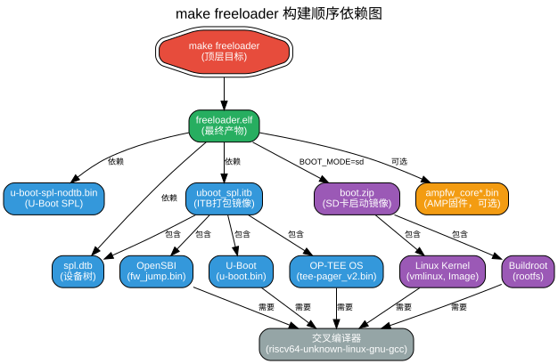

# make freeloader 的构建顺序

本文档详细说明执行 `make freeloader` 命令时的构建流程、依赖关系和构建机制。

## 一、概述

`make freeloader` 是 Nuclei Linux SDK 中用于构建第一阶段引导加载器（Freeloader）的命令。虽然目标是构建 `freeloader.elf`，但它会自动处理所有前置依赖的构建。

## 二、依赖关系图



## 三、构建顺序详解

### 3.1 顶层目标

```makefile
# Makefile 第 536-541 行
freeloader: $(freeloader_elf)
	@echo "freeloader is generated in $(freeloader_elf)"
```

`freeloader` 是一个伪目标（phony target），它依赖于 `$(freeloader_elf)`，即 `work/$(SOC)/freeloader/freeloader.elf`。

### 3.2 直接依赖项

`$(freeloader_elf)` 的直接依赖包括（第 567-571 行）：

| 依赖项 | 说明 | 必需性 |
|--------|------|--------|
| `$(uboot_spl_bin)` | U-Boot SPL 二进制 | ✅ 必需 |
| `$(uboot_spl_itb)` | ITB 打包镜像（OpenSBI+U-Boot+OP-TEE） | ✅ 必需 |
| `$(platform_dtb)` | 设备树二进制 | ✅ 必需 |
| `$(boot_zip)` | SD 卡启动镜像 | BOOT_MODE=sd 时需要 |
| `$(amp_bins)` | AMP 多核固件 | 可选 |

### 3.3 依赖的递归构建

Make 会自动递归处理所有依赖的构建：

#### 3.3.1 U-Boot SPL 构建链

```
$(uboot_spl_bin)
    ↓ 依赖
$(uboot_wrkdir)/.config
    ↓ 依赖
$(target_gcc) + $(uboot_config)
    ↓ 执行
编译 U-Boot → 生成 u-boot-spl-nodtb.bin
```

**构建命令**（第 506-508 行）：
```makefile
$(uboot_wrkdir)/.config: $(target_gcc) $(uboot_config)
	mkdir -p $(uboot_wrkdir)
	cp $(uboot_config) $@
	$(MAKE) -C $(uboot_srcdir) O=$(uboot_wrkdir) CROSS_COMPILE=$(CROSS_COMPILE) olddefconfig
```

#### 3.3.2 ITB 镜像构建链

`$(uboot_spl_itb)` 是最复杂的依赖，它需要：

```
$(uboot_spl_itb)
    ↓ 依赖
├── opensbi → $(opensbi_jumpbin) (fw_jump.bin)
├── uboot   → $(uboot_bin) (u-boot.bin)
├── optee_os → $(optee_os_bin) (tee-pager_v2.bin)
└── $(platform_dtb)
```

**ITB 打包过程**（第 510-529 行）：

```makefile
$(uboot_spl_itb): $(target_gcc) $(uboot_spl_its) $(platform_dtb) opensbi optee_os uboot
	mkdir -p $(uboot_spl_wrkdir)
	mkdir -p $(wrkdir)/keys
	# 复制各个组件
	cp -f $(opensbi_jumpbin) $(uboot_spl_wrkdir)/opensbi.bin
	cp -f $(uboot_bin) $(uboot_spl_wrkdir)/u-boot.bin
	cp -f $(optee_os_bin) $(uboot_spl_wrkdir)/optee.bin
	cp -f $(platform_dtb) $(uboot_spl_dtb)
	cp -f $(uboot_spl_its) $(uboot_spl_wrkdir)/spl.its
	# 生成安全启动密钥
	openssl genpkey -algorithm RSA -out keys/rsa_spl.key ...
	openssl req -batch -new -x509 -key keys/rsa_spl.key -out keys/rsa_spl.crt
	dd if=/dev/urandom of=$(wrkdir)/keys/aes_spl.bin bs=1 count=32
	# 打包 ITB
	$(uboot_mkimage) -f spl.its -K $(uboot_spl_dtb) -k $(wrkdir)/keys -r $@
```

#### 3.3.3 设备树构建链

```
$(platform_dtb)
    ↓ 依赖
$(platform_preproc_dts)
    ↓ 依赖
$(platform_dts) + $(target_gcc)
    ↓ 执行
预处理 (gcc -E) → 编译 (dtc) → 生成 .dtb
```

#### 3.3.4 Boot 镜像构建链（BOOT_MODE=sd 时）

```
$(boot_zip)
    ↓ 依赖
├── $(boot_image)    ← $(linux_image) + lz4 压缩
├── $(boot_initrd)   ← $(initramfs) + lz4 压缩
└── $(boot_kernel_dtb)
    ↓ 依赖
    ├── Linux Kernel (vmlinux, Image)
    ├── Buildroot Rootfs (rootfs.tar)
    └── ITB 打包 (kernel.itb)
```

### 3.4 交叉编译器准备

所有组件都依赖 `$(target_gcc)`，它由 buildroot 提供：

```makefile
$(target_gcc): $(buildroot_srcdir) $(buildroot_initramfs_wrkdir)/.config $(buildroot_initramfs_config)
	$(MAKE) -C $(buildroot_srcdir) RISCV=$(RISCV) O=$(buildroot_initramfs_wrkdir) toolchain
```

## 四、Freeloader 本体的构建

当所有依赖就绪后，执行 freeloader 的构建（第 572-578 行）：

```makefile
$(freeloader_elf): ...
	mkdir -p $(freeloader_wrkdir)
	$(MAKE) -C $(freeloader_srcdir) O=$(freeloader_wrkdir) \
		ARCH=$(ISA) ABI=$(ABI) ARCH_EXT=$(ARCH_EXT) \
		BOOT_MODE=$(BOOT_MODE) CROSS_COMPILE=$(CROSS_COMPILE) \
		UBOOT_SPL_BIN=$(uboot_spl_bin) UBOOT_SPL_ITB=$(uboot_spl_itb) \
		DTB=$(uboot_spl_dtb) KERNEL_BIN=$(boot_fitimage) \
		CONFIG_MK=$(freeloader_confmk) \
		CORE1_APP_BIN=$(CORE1_APP_BIN) ... CORE7_APP_BIN=$(CORE7_APP_BIN)
```

### 4.1 Freeloader Makefile 构建过程

进入 `freeloader/` 目录后（`freeloader/Makefile` 第 159-162 行）：

```makefile
$(FREELOADER): $(FREELOADER_REQS)
	$(CROSS_COMPILE)gcc $(CFLAGS) -I$(build_dir) freeloader.S -o $@ \
		-nostartfiles -L$(build_dir) -Tlinker.lds
	$(CROSS_COMPILE)size $@
```

关键参数：
- `-nostartfiles`：不使用标准启动文件
- `-Tlinker.lds`：使用自定义链接脚本
- `freeloader.S`：汇编源代码

### 4.2 生成的文件

构建完成后在 `work/$(SOC)/freeloader/` 目录生成：

| 文件 | 说明 |
|------|------|
| `freeloader.elf` | ELF 格式的引导加载器 |
| `freeloader.bin` | 纯二进制格式（用于烧录） |
| `freeloader.map` | 链接映射文件 |
| `freeloader.dasm` | 反汇编文件 |
| `spl.bin` | 复制的 U-Boot SPL |
| `spl.itb` | 复制的 ITB 镜像 |
| `spl.dtb` | 复制的设备树 |
| `spl_dtb.bin` | `spl.bin` 和 `spl.dtb` 的拼接文件 |

## 五、Make 的自动构建机制

### 5.1 时间戳检查

Make 通过比较文件时间戳决定是否重建：

```
如果 依赖文件比目标文件新:
    执行构建规则
否则:
    跳过（目标已是最新）
```

### 5.2 并行构建

可以使用 `-j` 参数加速构建：

```bash
make -j4 freeloader  # 使用 4 个并行任务
```

Make 会自动处理依赖的并行性，只有不相关的任务才会并行执行。

### 5.3 增量构建示例

**首次构建**（全部都需要构建）：
```bash
$ make freeloader
# 会看到完整的构建日志：
# 1. 编译 buildroot 工具链
# 2. 编译 Linux 内核
# 3. 编译 U-Boot
# 4. 编译 OpenSBI
# 5. 编译 OP-TEE
# 6. 打包 ITB
# 7. 生成 boot 镜像
# 8. 编译 freeloader
```

**增量构建**（只修改了 freeloader.S）：
```bash
$ make freeloader
# 只会看到：
# 编译 freeloader（其他都是 "Nothing to be done"）
```

## 六、关键 Makefile 变量

### 6.1 路径变量（第 108-111 行）

```makefile
freeloader_srcdir := $(srcdir)/freeloader      # 源码目录
freeloader_wrkdir := $(wrkdir)/freeloader      # 构建目录
freeloader_confmk := $(confdir)/freeloader.mk  # 配置文件
freeloader_elf := $(freeloader_wrkdir)/freeloader.elf  # 输出文件
```

### 6.2 配置变量

```makefile
SOC ?= evalsoc           # SoC 类型
CORE ?= ux900fd          # CPU 核心类型
BOOT_MODE ?= sd          # 启动模式（sd/flash）
ISA ?= rv64imafdc        # 指令集架构
ABI ?= lp64d             # 应用二进制接口
```

### 6.3 内存配置（conf/evalsoc/freeloader.mk）

```makefile
DDR_BASE ?= 0xc0000000       # DDR 基地址
CLM_BASE ?= 0x80000000       # Cluster Local Memory 基地址
FLASH_BASE ?= 0xa0000000     # Flash 基地址
FLASH_SIZE ?= 32M            # Flash 大小
ENABLE_SMP ?= 1              # 启用 SMP
ENABLE_L2 ?= 1               # 启用 L2 Cache
```

## 七、常见问题

### 7.1 构建失败怎么办？

检查依赖是否完整：
```bash
# 查看 freeloader 的所有依赖
make -d freeloader 2>&1 | grep "Considering target"
```

### 7.2 如何单独构建某个组件？

```bash
make uboot      # 只构建 U-Boot
make opensbi    # 只构建 OpenSBI
make optee      # 只构建 OP-TEE
make linux      # 只构建 Linux
```

### 7.3 如何强制重新构建？

```bash
make cleanfreeloader && make freeloader  # 清理并重建 freeloader
make clean && make freeloader            # 完全清理并全部重建
```

## 八、总结

`make freeloader` 的构建顺序遵循以下原则：

1. **依赖驱动**：Make 自动解析依赖树，按正确顺序构建
2. **按需构建**：只构建过期或缺失的组件
3. **递归处理**：每个依赖都有自己的构建规则和子依赖
4. **参数传递**：通过 Makefile 变量传递配置和路径信息

理解这个构建顺序有助于：
- 排查构建问题
- 优化构建时间
- 定制化修改流程
- 理解整个系统的启动流程

---

**文档生成日期**：2026-04-07  
**适用版本**：Nuclei Linux SDK (dev_nuclei_6.6_v2 分支)  
**相关文件**：
- `Makefile`（主 Makefile）
- `freeloader/Makefile`（Freeloader 构建）
- `conf/evalsoc/freeloader.mk`（内存配置）
- `conf/evalsoc/build.mk`（构建配置）
