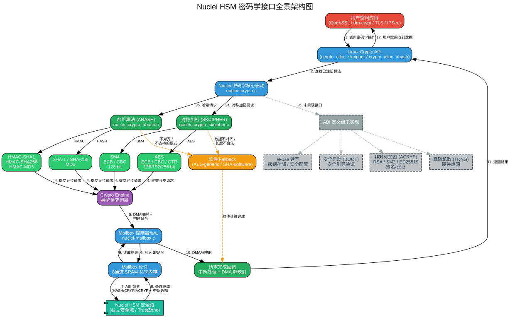

# Nuclei Linux 密码学接口

## 一、概述

Nuclei Linux SDK 的密码学接口基于 **Nuclei HSM（Hardware Security Module）硬件安全模块** 实现，通过 Mailbox 机制与独立的安全处理核通信，提供硬件加速的对称加密和哈希计算能力。

### 1.1 核心特点

- **异步架构**：基于 `crypto_engine` 框架，所有密码学操作异步执行
- **硬件加速**：通过 Mailbox 与 HSM 安全核通信，实现硬件级加密加速
- **Fallback 机制**：数据不符合硬件要求时，自动降级到软件算法
- **DMA 零拷贝**：支持 DMA 直接访问，减少内存拷贝开销
- **多通道并行**：Mailbox 支持 8 通道并行通信

---

## 二、支持的密码学算法

### 2.1 已实现的接口

#### 对称加密（SKCIPHER）

| 算法 | 模式 | 密钥长度 | 实现文件 | 状态 |
|------|------|----------|----------|------|
| AES | ECB | 128/192/256 bit | `nuclei_crypto_skcipher.c` | ✅ 完整 |
| AES | CBC | 128/192/256 bit | `nuclei_crypto_skcipher.c` | ✅ 完整 |
| AES | CTR | 128/192/256 bit | `nuclei_crypto_skcipher.c` | ⚠️ 已注册但可能禁用 |
| SM4 | ECB | 128 bit | `nuclei_crypto_skcipher.c` | ✅ 完整 |
| SM4 | CBC | 128 bit | `nuclei_crypto_skcipher.c` | ✅ 完整 |

#### 哈希算法（AHASH）

| 算法 | 摘要长度 | 实现文件 | 状态 |
|------|----------|----------|------|
| SHA-1 | 160 bit | `nuclei_crypto_ahash.c` | ✅ 完整 |
| SHA-256 | 256 bit | `nuclei_crypto_ahash.c` | ✅ 完整 |
| MD5 | 128 bit | `nuclei_crypto_ahash.c` | ✅ 完整 |

#### HMAC 算法

| 算法 | 说明 | 实现文件 | 状态 |
|------|------|----------|------|
| HMAC-SHA1 | 基于 SHA-1 的 HMAC | `nuclei_crypto_ahash.c` | ✅ 完整 |
| HMAC-SHA256 | 基于 SHA-256 的 HMAC | `nuclei_crypto_ahash.c` | ✅ 完整 |
| HMAC-MD5 | 基于 MD5 的 HMAC | `nuclei_crypto_ahash.c` | ✅ 完整 |

### 2.2 ABI 定义但未实现的接口

| 接口类型 | ABI Opcode | 具体功能 | 说明 |
|----------|------------|----------|------|
| **非对称加密 (ACRYP)** | 3 | RSA-PSS-2048/4096, SM2, ED25519, 模幂运算 | Linux 驱动尚未实现 |
| **真随机数 (TRNG)** | 4 | 硬件熵源生成随机数 | 可用于密钥生成 |
| **eFuse 读写** | 5 | 6组对称密钥 + 4组公钥的安全存储 | 安全密钥管理 |
| **安全启动 (BOOT)** | 6 | 安全引导验证 | 启动链验证 |

---

## 三、架构设计

### 3.1 整体架构图



### 3.2 层次结构

```
┌─────────────────────────────────────────────┐
│           用户空间层                           │
│  (OpenSSL / dm-crypt / TLS / IPSec)        │
└──────────────┬──────────────────────────────┘
               │ 系统调用
┌──────────────▼──────────────────────────────┐
│           Linux Crypto API                   │
│  crypto_alloc_skcipher()                    │
│  crypto_alloc_ahash()                       │
└──────────────┬──────────────────────────────┘
               │
┌──────────────▼──────────────────────────────┐
│           Nuclei 密码学核心驱动               │
│           nuclei_crypto.c                    │
│  - 算法注册/注销                             │
│  - Mailbox 回调处理                          │
│  - debugfs 统计                              │
└──────┬─────────────┬─────────────┬──────────┘
       │             │             │
┌──────▼─────┐ ┌────▼────┐ ┌─────▼─────┐
│  对称加密   │ │  哈希   │ │  未实现    │
│ SKCIPHER  │ │  AHASH  │ │  (ACRYP)  │
│AES/SM4    │ │SHA/MD5  │ │(TRNG)     │
│ECB/CBC/CTR│ │HMAC     │ │(eFuse)    │
└──────┬─────┘ └────┬────┘ └───────────┘
       │            │
┌──────▼────────────▼───────────────────────┐
│           Crypto Engine                    │
│  异步请求调度队列                           │
└──────────────┬────────────────────────────┘
               │
┌──────────────▼────────────────────────────┐
│           Mailbox 控制器驱动               │
│           nuclei-mailbox.c                 │
│  - 8通道 SRAM 共享内存                     │
│  - 中断处理                                 │
└──────────────┬────────────────────────────┘
               │
┌──────────────▼────────────────────────────┐
│           HSM 安全核硬件                    │
│  (独立安全域 / TrustZone)                  │
└───────────────────────────────────────────┘
```

---

## 四、核心组件详解

### 4.1 核心驱动（`nuclei_crypto.c`）

#### 职责
- **算法注册**：在 `nuclei_crypto_probe()` 中注册所有密码学算法
- **Mailbox 初始化**：通过 `nuclei_mb_init()` 建立 Mailbox 通信通道
- **回调分发**：`nuclei_mb_rx_callback()` 根据返回数据类型分发给 skcipher 或 ahash 完成处理

#### 注册的算法列表
```c
static struct nuclei_crypto_tmp *nuclei_cipher_algs[] = {
    &nuclei_ecb_aes_alg,       // AES-ECB
    &nuclei_cbc_aes_alg,       // AES-CBC
    // &nuclei_ctr_aes_alg,    // AES-CTR（已注释）
    &nuclei_ecb_sm4_alg,       // SM4-ECB
    &nuclei_cbc_sm4_alg,       // SM4-CBC
    &nuclei_ahash_hash_sha1,   // SHA-1
    &nuclei_ahash_hash_sha256, // SHA-256
    &nuclei_ahash_hash_md5,    // MD5
    &nuclei_ahash_hmac_sha1,   // HMAC-SHA1
    &nuclei_ahash_hmac_sha256, // HMAC-SHA256
    &nuclei_ahash_hmac_md5,    // HMAC-MD5
};
```

#### 算法优先级
- **优先级值**：`NUCLEI_CRYPTO_PRIORITY = 300`
- **标志位**：`CRYPTO_ALG_ASYNC | CRYPTO_ALG_NEED_FALLBACK`
  - `CRYPTO_ALG_ASYNC`：异步算法
  - `CRYPTO_ALG_NEED_FALLBACK`：需要软件 fallback

### 4.2 对称加密驱动（`nuclei_crypto_skcipher.c`）

#### 数据结构

```c
// 算法上下文（per-TFM）
struct nuclei_cipher_ctx {
    unsigned int keylen;           // 密钥长度
    u8 key[AES_MAX_KEY_SIZE];      // 密钥数据（最大 256 bit）
    u8 iv[AES_BLOCK_SIZE];         // IV 向量
    struct crypto_skcipher *fallback_tfm;  // 软件 fallback
};

// 请求上下文（per-request）
struct nuclei_cipher_rctx {
    struct nuclei_crypto_info *dev;
    mailbox_cryp_cmd_in_token cipher_cmd_desc;  // HSM 命令
    void *buf;                     // DMA 缓冲区
    dma_addr_t buf_dma;            // DMA 物理地址
    size_t buflen;
    struct skcipher_request fallback_req;
};
```

#### Fallback 判断条件

```c
static int nuclei_cipher_need_fallback(struct skcipher_request *req)
{
    // 1. 数据长度为 0
    if (!req->cryptlen)
        return true;
    
    // 2. scatterlist 偏移未按 4 字节对齐
    if (!IS_ALIGNED(sgs->offset, sizeof(u32)))
        return true;
    
    // 3. 数据长度不是块大小的整数倍
    if (stodo % bs)
        return true;
    
    // 4. 源和目标 scatterlist 长度不一致
    if (stodo != dtodo)
        return true;
    
    return false;
}
```

#### 硬件执行流程（`nuclei_cipher_run`）

1. **分配 DMA 缓冲区**：按块大小对齐分配
2. **数据拷贝**：将 scatterlist 数据拷贝到线性缓冲区
3. **DMA 映射**：`dma_map_single()` 映射为设备可访问地址
4. **构建命令**：填充 `mailbox_cryp_cmd_in_token` 结构
   - Opcode：`SECURE_SERVICE_OPCODE_CRYP = 2`
   - 算法：`SECURE_SERVICE_CRYP_AES = 0` 或 `SECURE_SERVICE_CRYP_SM4 = 1`
   - 模式：`ECB = 0`, `CBC = 1`, `CTR = 2`
   - 密钥长度：128/192/256 bit
   - 数据地址：64 位 DMA 地址（`addr_low` + `addr_hig`）
5. **发送命令**：`mbox_send_message()` 通过 Mailbox 发送
6. **异步返回**：等待中断回调

#### 完成回调（`nuclei_skcipher_done`）

1. **DMA 解映射**：`dma_unmap_single()`
2. **结果拷贝**：将数据从线性缓冲区拷贝回 scatterlist
3. **IV 更新**：CBC/CTR 模式需要更新 IV
4. **完成通知**：`crypto_finalize_skcipher_request()`

### 4.3 哈希驱动（`nuclei_crypto_ahash.c`）

#### 数据结构

```c
// 哈希上下文（per-TFM）
struct nuclei_ahash_ctx {
    unsigned int keylen;
    u8 key[128];                   // HMAC 密钥
    struct crypto_ahash *fallback_tfm;
};

// 请求上下文（per-request）
struct nuclei_ahash_rctx {
    struct nuclei_crypto_info *dev;
    mailbox_hash_cmd_in_token hash_cmd_desc;
    u32 mode;                      // INIT/UPDATE/FINAL/FINUP/DIGEST
    u32 data_times;
    int nrsg;                      // scatterlist 数量
    struct ahash_request fallback_req;
};
```

#### 哈希操作模式

| 模式 | 值 | 说明 |
|------|-----|------|
| `HASH_MODE_INIT` | 0 | 初始化哈希状态 |
| `HASH_MODE_UPDATE` | 1 | 更新哈希数据 |
| `HASH_MODE_FINAL` | 2 | 完成哈希计算 |
| `HASH_MODE_FINUP` | 3 | 更新并完成 |
| `HASH_MODE_DIGEST` | 4 | 一次性计算 |

#### HMAC 密钥处理

```c
static int nuclei_ahash_setkey(struct crypto_ahash *tfm,
                               const u8 *key, unsigned int keylen)
{
    // 密钥长度超过块大小时，先哈希密钥
    if (keylen > blocksize) {
        u8 *result = kmalloc(digestsize, GFP_KERNEL);
        nuclei_calc_key_hash("sha256", key, keylen, result);
        ctx->keylen = digestsize;
        memcpy(ctx->key, result, digestsize);
    } else {
        memcpy(ctx->key, key, keylen);
        ctx->keylen = keylen;
    }
}
```

#### 零消息处理

HSM 硬件不支持处理空消息（zero-length message），驱动中使用预计算的固定哈希值：

```c
static int zero_message_process(struct ahash_request *req)
{
    switch (nuclei_digest_size) {
    case SHA1_DIGEST_SIZE:
        memcpy(req->result, sha1_zero_message_hash, ...);
        break;
    case SHA256_DIGEST_SIZE:
        memcpy(req->result, sha256_zero_message_hash, ...);
        break;
    case MD5_DIGEST_SIZE:
        memcpy(req->result, md5_zero_message_hash, ...);
        break;
    }
}
```

#### 哈希执行流程（`nuclei_ahash_run`）

1. **DMA 映射**：`dma_map_sg()` 映射 scatterlist
2. **构建命令**：填充 `mailbox_hash_cmd_in_token`
   - Opcode：`SECURE_SERVICE_OPCODE_HASH = 1`
   - 算法：`SHA1 = 1`, `MD5 = 2`, `SHA256 = 4`
   - 模式：`HASH_MODE = 0`, `HMAC_MODE = 1`
   - 控制：`IN_ALL = 0`, `IN_INIT = 1`, `IN_UPDATE = 2`, `IN_END = 3`
3. **多段数据处理**：对于多个 scatterlist，分段发送命令
4. **同步等待**：使用 `wait_for_completion_interruptible_timeout()` 等待完成

### 4.4 Mailbox 驱动（`nuclei-mailbox.c`）

#### 硬件寄存器

| 寄存器 | 偏移 | 说明 |
|--------|------|------|
| `MAILBOX_CSR` | 0x08 | 控制状态寄存器 |
| `MAILBOX_LINKID0` | 0x10 | 通道 0 链接 ID |
| `MAILBOX_LOCKOUT0` | 0x18 | 通道 0 锁定状态 |
| `MAILBOX_INT_EN` | 0x38 | 中断使能 |
| `MAILBOX_INT_STAT` | 0x3C | 中断状态 |
| `MAILBOX_SRAM` | 0x2000 | 共享内存起始地址 |

#### 消息格式

- **消息大小**：`0x100`（256 字节）
- **通道数**：最多 8 个通道
- **通道偏移**：`MAILBOX_SRAM + ch * MAILBOX_MSG_SIZE`

#### 通信流程

```
发送方：
1. 将命令数据拷贝到 SRAM（mbox_msg_buf）
2. 设置 MAILBOX_CSR_IN_FULL 位通知接收方
3. 等待接收方处理

接收方（HSM）：
1. 检测到 MAILBOX_CSR_IN_FULL
2. 从 SRAM 读取命令
3. 处理完成后设置 MAILBOX_CSR_OUT_FULL
4. 触发中断通知发送方
```

#### 中断处理

```c
static irqreturn_t nuclei_mbox_irq(int irq, void *dev_id)
{
    // 1. 读取中断状态
    val = readl(mbox->regs + MAILBOX_INT_STAT);
    
    // 2. 检查 DONE 位
    if (val & (MAILBOX_INT_STAT_DONE << (2 * ch))) {
        // 3. 读取返回数据
        msg.data = mbox->regs + MAILBOX_SRAM + ch * MAILBOX_MSG_SIZE;
        
        // 4. 通知上层回调
        mbox_chan_received_data(link, &msg);
        
        // 5. 清除中断
        writel(val, mbox->regs + MAILBOX_INT_STAT);
        
        // 6. 清除 OUT_FULL
        val = readl(mbox->regs + MAILBOX_CSR);
        val |= MAILBOX_CSR_OUT_FULL << (4 * ch);
        writel(val, mbox->regs + MAILBOX_CSR);
    }
}
```

---

## 五、ABI 协议详解

### 5.1 命令结构

#### 公共头部

```c
struct common_head_t {
    uint32_t TokenID : 16;   // 保留，用于识别请求类型
    uint32_t reserved : 8;
    uint32_t subcode : 4;
    uint32_t opcode : 4;     // 服务类型
};
```

#### 服务类型（Opcode）

| 值 | 服务 | 说明 |
|----|------|------|
| 1 | HASH | 哈希计算 |
| 2 | CRYP | 对称加密 |
| 3 | ACRYP | 非对称加密 |
| 4 | TRNG | 真随机数 |
| 5 | EFUSE | eFuse 读写 |
| 6 | BOOT | 安全启动 |

### 5.2 对称加密命令（CRYP）

```c
typedef struct {
    struct common_head_t header;
    uint32_t identity;
    uint32_t length;                    // 总输入长度
    uint32_t input_data_addr_low;       // 输入地址低 32bit
    uint32_t input_data_addr_hig;       // 输入地址高 32bit
    uint32_t input_data_length;         // 输入数据长度
    uint32_t output_data_addr_low;      // 输出地址低 32bit
    uint32_t output_data_addr_hig;      // 输出地址高 32bit
    uint32_t output_data_length;        // 输出数据长度
    struct cryp_cmd_cfg cmd_cfg;
} cryp_in_token_t;

struct cryp_cmd_cfg {
    uint32_t algo : 4;          // 0=AES, 1=SM4
    uint32_t mode : 4;          // 0=ECB, 1=CBC, 2=CTR, 3=CMAC
    uint32_t key_length : 4;    // 0=128, 1=192, 2=256
    uint32_t NonceLength : 4;
    uint32_t encryp : 1;        // 0=加密, 1=解密
    uint32_t key_sel : 4;       // 0=配置密钥, 1-6=硬件密钥组
    uint32_t in_ctrl : 4;       // 0=ALL
    uint32_t reserved : 7;
};
```

### 5.3 哈希命令（HASH）

```c
typedef struct {
    struct common_head_t header;
    uint32_t identity;
    uint32_t length;                    // 总输入长度
    uint32_t input_data_addr_low;       // 输入地址
    uint32_t input_data_addr_hig;
    uint32_t input_data_length;         // 输入数据长度
    uint32_t key_data_addr_low;         // HMAC 密钥地址
    uint32_t key_data_addr_hig;
    struct cmd_cfg_t cmd_cfg;
} hash_in_token_t;

struct cmd_cfg_t {
    uint32_t algo : 4;          // 1=SHA1, 2=MD5, 4=SHA256
    uint32_t mode : 4;          // 0=HASH, 1=HMAC
    uint32_t w_r : 1;
    uint32_t keyLen : 8;        // HMAC 密钥长度
    uint32_t in_ctrl : 4;       // 0=ALL, 1=INIT, 2=UPDATE, 3=END
    uint32_t reserved : 11;
};
```

### 5.4 密钥来源配置

```c
#define SECURE_SERVICE_CRYP_KEY_SEL_CFG     0   // 软件配置密钥（当前使用）
#define SECURE_SERVICE_CRYP_KEY_SEL_GRP0    1   // 硬件密钥组 0
#define SECURE_SERVICE_CRYP_KEY_SEL_GRP1    2   // 硬件密钥组 1
// ... 最多 6 组硬件密钥
```

**当前限制**：驱动只使用 `SECURE_SERVICE_CRYP_KEY_SEL_CFG`，硬件密钥组尚未启用。

---

## 六、调用流程

### 6.1 对称加密调用流程

```
用户空间（OpenSSL）
    │
    ▼
crypto_alloc_skcipher("ecb(aes)")
    │
    ▼
Linux Crypto API
    │
    ▼
nuclei_aes_ecb_encrypt(req)         // 入口函数
    │
    ▼
nuclei_cipher_crypt(req, algo, mode, encrypt)
    │
    ▼
nuclei_cipher_handle_req(req)
    │
    ├── 需要 Fallback？ ──→ nuclei_cipher_fallback(req) ──→ 软件算法
    │
    ▼
crypto_transfer_skcipher_request_to_engine(engine, req)
    │
    ▼
Crypto Engine 调度队列
    │
    ▼
nuclei_cipher_run(engine, async_req)    // 实际执行
    │
    ├── 1. 分配 DMA 缓冲区
    ├── 2. sg_copy_to_buffer() 拷贝数据
    ├── 3. dma_map_single() DMA 映射
    ├── 4. 填充 mailbox_cryp_cmd_in_token
    └── 5. mbox_send_message() 发送命令
                │
                ▼
        Mailbox 驱动写入 SRAM
                │
                ▼
        HSM 安全核处理
                │
                ▼
        中断通知处理完成
                │
                ▼
        nuclei_mb_rx_callback()
                │
                ▼
        nuclei_skcipher_done()
            ├── 1. dma_unmap_single()
            ├── 2. sg_copy_from_buffer() 拷贝结果
            ├── 3. 更新 IV（CBC/CTR）
            └── 4. crypto_finalize_skcipher_request()
                        │
                        ▼
                回调用户完成函数
```

### 6.2 哈希调用流程

```
用户空间（OpenSSL）
    │
    ▼
crypto_alloc_ahash("sha256")
    │
    ▼
Linux Crypto API
    │
    ▼
nuclei_ahash_digest(req)            // 入口函数
    │
    ▼
nuclei_ahash_handle_req(req)
    │
    ├── 需要 Fallback？ ──→ nuclei_ahash_digest_fb(req) ──→ 软件算法
    ├── 零长度消息？ ──→ zero_message_process(req) ──→ 固定哈希值
    │
    ▼
crypto_transfer_hash_request_to_engine(engine, req)
    │
    ▼
nuclei_ahash_run(engine, breq)      // 实际执行
    │
    ├── 1. dma_map_sg() 映射 scatterlist
    ├── 2. 循环处理每个 scatterlist：
    │       nuclei_ahash_cmd_setup() 构建命令
    │       mbox_send_message() 发送
    │       wait_for_completion_timeout() 等待完成
    │   （最后一段使用 SECURE_SERVICE_IN_END）
    │
    ▼
HSM 处理完成后中断返回
    │
    ▼
nuclei_ahash_done()
    ├── 1. 读取结果（偏移 8 字节处）
    ├── 2. be32_to_cpu() 字节序转换
    └── 3. crypto_finalize_hash_request()
```

---

## 七、Fallback 机制

### 7.1 Fallback 触发条件

#### 对称加密

| 条件 | 说明 | 统计计数器 |
|------|------|------------|
| 数据长度为 0 | 无数据需要处理 | - |
| 偏移不对齐 | `sg->offset` 不是 4 字节倍数 | `stat_fb_align` |
| 长度不对齐 | 数据长度不是块大小倍数 | `stat_fb_len` |
| SG 长度不一致 | 源和目标 scatterlist 长度不同 | `stat_fb_sgdiff` |

#### 哈希

| 条件 | 说明 |
|------|------|
| 偏移不对齐 | `sg->offset` 不是 4 字节倍数 |
| 零长度消息 | 返回预计算哈希值（不走 fallback） |
| UPDATE/FINAL 模式 | 当前版本全部走 fallback |

### 7.2 Fallback 实现

每个算法实例在初始化时分配对应的软件 fallback 算法：

```c
// 对称加密
ctx->fallback_tfm = crypto_alloc_skcipher(name, 0, CRYPTO_ALG_NEED_FALLBACK);

// 哈希
tctx->fallback_tfm = crypto_alloc_ahash(alg_name, 0, CRYPTO_ALG_NEED_FALLBACK);
```

当需要 fallback 时，将请求参数转发给 fallback 算法：

```c
skcipher_request_set_tfm(&rctx->fallback_req, op->fallback_tfm);
skcipher_request_set_callback(&rctx->fallback_req, ...);
skcipher_request_set_crypt(&rctx->fallback_req, src, dst, cryptlen, iv);
return crypto_skcipher_encrypt(&rctx->fallback_req);  // 或 decrypt
```

### 7.3 调试统计

通过 debugfs 查看 fallback 统计：

```bash
cat /sys/kernel/debug/nuclie_crypto/stats
```

输出示例：
```
ecb(aes)-nuclei ecb(aes) reqs=1000 fallback=50
    fallback due to length: 20
    fallback due to alignment: 30
    fallback due to SGs: 0
sha256-nuclei sha256 reqs=500 fallback=10
```

---

## 八、设备树配置

### 8.1 Mailbox 节点

```dts
mailbox: mailbox@18031000 {
    compatible = "nuclei,nuclei-mbox";
    reg = <0x0 0x18031000 0x0 0x1000>;
    interrupts = <19>;
    #mbox-cells = <1>;
};
```

### 8.2 密码学节点

```dts
crypto: crypto@18032000 {
    compatible = "nuclei,nuclei-crypto";
    reg = <0x0 0x18032000 0x0 0x1000>;
    mboxes = <&mailbox 0>;
};
```

---

## 九、相关文件清单

| 文件路径 | 说明 |
|----------|------|
| `linux/drivers/crypto/nuclei/nuclei_crypto.c` | 核心驱动，算法注册，Mailbox 回调 |
| `linux/drivers/crypto/nuclei/nuclei_crypto_skcipher.c` | 对称加密算法实现（AES/SM4） |
| `linux/drivers/crypto/nuclei/nuclei_crypto_ahash.c` | 哈希算法实现（SHA/MD5/HMAC） |
| `linux/drivers/crypto/nuclei/nuclei_crypto.h` | 数据结构定义 |
| `linux/drivers/crypto/nuclei/nuclei_abi.h` | HSM ABI 协议定义 |
| `linux/drivers/mailbox/nuclei-mailbox.c` | Mailbox 控制器驱动 |
| `linux/include/linux/mailbox/nuclei_mailbox.h` | Mailbox 消息结构定义 |

---

## 十、限制与注意事项

### 10.1 当前限制

1. **哈希 UPDATE/FINAL**：当前版本所有 UPDATE/FINAL 操作都走软件 fallback
2. **硬件密钥组**：ABI 支持 6 组硬件密钥，但驱动只使用软件配置密钥
3. **非对称加密**：ABI 定义了 RSA/SM2/ED25519，但 Linux 驱动尚未实现
4. **真随机数**：TRNG 接口已定义但未实现 Linux 驱动
5. **eFuse**：安全密钥存储接口已定义但未实现
6. **CTR 模式**：AES-CTR 在 `nuclei_cipher_algs[]` 中被注释掉

### 10.2 使用建议

1. **数据对齐**：确保输入数据 4 字节对齐，减少 fallback
2. **块大小倍数**：对称加密数据长度应为块大小（16 字节）的倍数
3. **内存分配**：DMA 缓冲区由驱动分配，不需要用户处理
4. **异步回调**：使用异步 API 时，确保提供完成回调函数

### 10.3 性能优化

- **批量处理**：尽量批量提交请求，利用 Crypto Engine 的调度能力
- **避免 Fallback**：确保数据对齐和长度合法，减少软件 fallback
- **DMA 连续内存**：使用连续的内存缓冲区，避免 scatterlist 碎片化

---

*文档版本：基于 dev_nuclei_6.6_v2 分支*
*最后更新：2024年*
