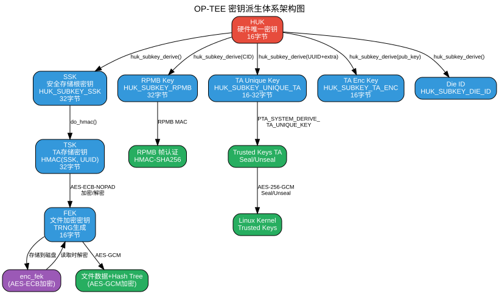

# OP-TEE 密钥体系说明

## 1. 概述

本文档总结 OP-TEE（Open Portable Trusted Execution Environment）中的密钥体系，基于 `nuclei-linux-sdk/optee/optee_os` 本地代码分析。

## 2. HUK（Hardware Unique Key）

### 2.1 定义

HUK 是所有密钥的根，结构定义如下：

```c
// core/include/kernel/tee_common_otp.h:14-16
struct tee_hw_unique_key {
    uint8_t data[HW_UNIQUE_KEY_LENGTH];  // 16字节 (128位)
};
```

`HW_UNIQUE_KEY_LENGTH = 16` 定义在 `lib/libutee/include/utee_defines.h:304`。

### 2.2 来源

HUK 通过 `tee_otp_get_hw_unique_key()` 获取，默认实现为 weak stub：

```c
// core/arch/riscv/kernel/otp_stubs.c:20-24
__weak TEE_Result tee_otp_get_hw_unique_key(struct tee_hw_unique_key *hwkey)
{
    memset(&hwkey->data[0], 0, sizeof(hwkey->data));
    return TEE_SUCCESS;
}
```

⚠️ **Nuclei 平台安全警告**：当前 `core/arch/riscv/plat-nuclei/main.c` 未覆盖该 weak stub，使用的是**全零的不安全 HUK**。生产环境必须通过 eFuse/PUF/HSM 提供真实的设备唯一密钥。

## 3. HUK 子密钥派生引擎

### 3.1 核心函数

`huk_subkey_derive()` 位于 `core/kernel/huk_subkey.c:61-107`，公式为：

```
subkey = HMAC-SHA256(HUK, usage_id || const_data)
```

### 3.2 用途枚举

```c
// core/include/kernel/huk_subkey.h:25-36
enum huk_subkey_usage {
    HUK_SUBKEY_RPMB = 0,        // RPMB 认证密钥
    HUK_SUBKEY_SSK = 1,         // Secure Storage 根密钥
    HUK_SUBKEY_DIE_ID = 2,      // 芯片 Die ID
    HUK_SUBKEY_UNIQUE_TA = 3,   // TA 唯一密钥
    HUK_SUBKEY_TA_ENC = 4,      // TA 二进制加密密钥
    HUK_SUBKEY_SE050 = 5,       // SE050 SCP03 密钥
};
```

### 3.3 兼容模式

本地构建配置（`work/evalsoc/optee/optee_os/conf.mk`）：

```makefile
CFG_CORE_HUK_SUBKEY_COMPAT=y
CFG_CORE_HUK_SUBKEY_COMPAT_USE_OTP_DIE_ID=n
```

在兼容模式下，`huk_subkey.c:37-58` 对 SSK 额外混入 chip ID（因 `USE_OTP_DIE_ID=n`，chip ID 是重复的 `"BEEF"` 字符串）和固定字符串 `"ONLY_FOR_tee_fs_ssk"`。

## 4. 密钥派生体系架构图



## 5. Secure Storage 密钥链（REE FS）

### 5.1 完整层次

```
HUK (16B)
  └─ huk_subkey_derive(HUK_SUBKEY_SSK)
     └─ SSK (32B)  [全局，启动时派生，驻留内存]
        └─ do_hmac(SSK, TA_UUID)
           └─ TSK (32B)  [每个 TA 唯一]
              └─ AES-ECB-NOPAD
                 └─ FEK (16B, 随机生成)
                    ├─ enc_fek (存储在磁盘)
                    └─ AES-GCM
                       └─ 文件数据 + Hash Tree 元数据
```

### 5.2 SSK（Secure Storage Key）

```c
// core/tee/tee_fs_key_manager.c:139-153
res = huk_subkey_derive(HUK_SUBKEY_SSK, NULL, 0,
                        tee_fs_ssk.key, sizeof(tee_fs_ssk.key));
```

- 大小：32 字节
- 在 `service_init_late` 时初始化
- 全局唯一，常驻内存

### 5.3 TSK（TA Storage Key）

```c
// core/tee/tee_fs_key_manager.c:92-96
res = do_hmac(tsk, sizeof(tsk), tee_fs_ssk.key,
              TEE_FS_KM_SSK_SIZE, uuid, sizeof(*uuid));
```

- 从 SSK + TA UUID 派生
- 若 `uuid == NULL`，用 1 字节 `{0}` 避免冲突
- 专门用于加密/解密 FEK

### 5.4 FEK（File Encryption Key）

```c
// core/tee/tee_fs_key_manager.c:134-137
static TEE_Result generate_fek(uint8_t *key, uint8_t len) {
    return crypto_rng_read(key, len);  // 16字节真随机数
}
```

FEK 生成后立即被 TSK 加密为 `enc_fek`，存储在 Hash Tree 头部：

```c
// core/include/tee/fs_htree.h:52-58
struct tee_fs_htree_image {
    uint8_t iv[TEE_AES_BLOCK_SIZE];
    uint8_t tag[TEE_AES_BLOCK_SIZE];
    uint8_t enc_fek[TEE_FS_KM_FEK_SIZE];  // 16字节
    uint32_t counter;
};
```

文件打开时解密恢复 FEK：

```c
// core/tee/fs_htree.c:549-552
res = tee_fs_fek_crypt(ht->uuid, TEE_MODE_DECRYPT, ht->head.enc_fek,
                       sizeof(ht->fek), ht->fek);
```

**没有单独的 metadata key**，同一个 FEK 同时加密文件头部、Hash Tree 节点和数据块，完整性由 SHA256 Hash Tree 保证。

## 6. RPMB 密钥

RPMB 密钥从 HUK + eMMC CID 派生：

```c
// core/tee/tee_rpmb_fs.c:329-333
memcpy(message, rpmb_ctx->cid, RPMB_EMMC_CID_SIZE);
memset(message + RPMB_CID_PRV_OFFSET, 0, 1);   // 屏蔽产品版本
memset(message + RPMB_CID_CRC_OFFSET, 0, 1);   // 屏蔽 CRC
return huk_subkey_derive(HUK_SUBKEY_RPMB, message, sizeof(message),
                         key, len);
```

- 大小：32 字节
- 用于 RPMB 帧的 HMAC-SHA256 认证
- 若定义 `CFG_RPMB_TESTKEY`，使用硬编码测试密钥（仅调试）

## 7. Trusted Keys TA 与 PTA 密钥派生

### 7.1 System PTA 接口

System PTA 提供命令 `PTA_SYSTEM_DERIVE_TA_UNIQUE_KEY`（`pta_system.h:51`）：

```c
// core/pta/system.c:58-115
static TEE_Result system_derive_ta_unique_key(...)
{
    // 构造 data = TA_UUID || extra_data
    memcpy(data, &uctx->ts_ctx->uuid, sizeof(TEE_UUID));
    memcpy(data + sizeof(TEE_UUID), params[0].memref.buffer, ...);
    
    // 派生密钥
    res = huk_subkey_derive(HUK_SUBKEY_UNIQUE_TA, data, data_len,
                            params[1].memref.buffer,
                            params[1].memref.size);
}
```

**UUID 的作用**：作为 `const_data` 的前 16 字节，确保不同 TA 即使提供相同的 extra_data 也会得到不同的密钥，实现 TA 间密钥隔离。

### 7.2 Trusted Keys TA 的使用

```c
// ta/trusted_keys/entry.c:60-93
static TEE_Result derive_unique_key(...)
{
    TEE_OpenTASession(PTA_SYSTEM_UUID, ...);
    TEE_InvokeTACommand(..., PTA_SYSTEM_DERIVE_TA_UNIQUE_KEY, ...);
}
```

派生出的密钥用于 AES-256-GCM，为 Linux Kernel 的 Trusted Keys 子系统提供 seal/unseal 服务。访问严格限制为 `TEE_LOGIN_REE_KERNEL`（`entry.c:316`），仅 Linux 内核可调用。

## 8. 密钥使用全景表

| 密钥 | 来源 | 大小 | 用途 | 关键文件 |
|------|------|------|------|----------|
| **HUK** | OTP/eFuse/PUF | 16B | 所有子密钥的根 | `otp_stubs.c:20` |
| **SSK** | `huk_subkey_derive(HUK_SUBKEY_SSK)` | 32B | Secure Storage 根密钥 | `tee_fs_key_manager.c:145` |
| **TSK** | `HMAC-SHA256(SSK, UUID)` | 32B | 每个 TA 的存储密钥 | `tee_fs_key_manager.c:93` |
| **FEK** | TRNG | 16B | 文件数据+元数据加密 | `tee_fs_key_manager.c:136` |
| **RPMB Key** | `huk_subkey_derive(HUK_SUBKEY_RPMB, CID)` | 32B | RPMB 帧认证 | `tee_rpmb_fs.c:332` |
| **TA Unique Key** | `huk_subkey_derive(HUK_SUBKEY_UNIQUE_TA, UUID\|\|extra)` | 16-32B | 给特定 TA 的设备唯一密钥 | `core/pta/system.c:109` |
| **TA Enc Key** | `huk_subkey_derive(HUK_SUBKEY_TA_ENC, pub_key)` | 16B | 加密 TA 二进制镜像 | `otp_stubs.c:49` |

## 9. 关键结论

1. **HUK 是根**：所有安全密钥最终都派生自 HUK。HUK 的实现质量决定整个 TEE 的安全基线。
2. **Nuclei 平台当前 HUK 为全零**：`plat-nuclei` 未实现真实的 `tee_otp_get_hw_unique_key()`，生产环境必须补充。
3. **派生目标是隔离**：`usage_id` 实现用途隔离，`UUID` 实现 TA 隔离，`extra_data` 实现场景隔离。
4. **Secure Storage 三层密钥链**：HUK→SSK（全局）→TSK（每TA）→FEK（每文件）。FEK 始终以 `enc_fek` 形式存储。
5. **Trusted Keys 是内核与 TEE 的桥梁**：通过设备绑定（HUK）+ TA 隔离（UUID）提供双重安全保障。

---

*文档版本：基于 dev_nuclei_6.6_v2 分支本地代码分析*  
*生成日期：2026-04-17*
