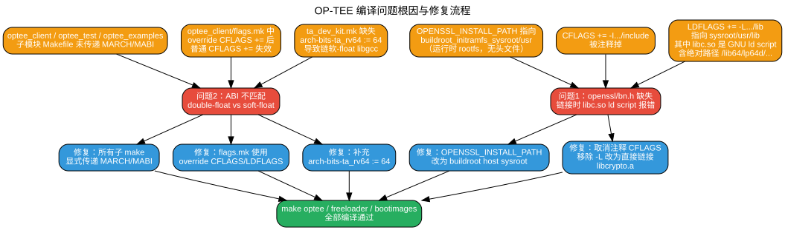

# OP-TEE 编译问题修复报告

## 一、项目背景

本项目为 **Nuclei Linux SDK**（`dev_nuclei_6.6_v2` 分支），目标平台为 `evalsoc / ux900fd (rv64imafdc)`。在启用 OP-TEE 支持后，执行 `make optee` 时遭遇编译失败，涉及 `optee_test`、`optee_client`、`optee_examples` 及 `optee_os` 等多个子模块。

---

## 二、问题现象

在执行 `make optee` 过程中，出现以下两类核心错误：

1. **`openssl/bn.h` 缺失** — `optee_test` 的 `host/xtest` 编译阶段报错找不到 OpenSSL 头文件。
2. **ABI 不匹配** — 链接阶段出现 `can't link double-float modules with soft-float modules`，波及 `optee_client`、`optee_test`、`optee_examples` 及 TA（Trusted Application）的链接。

---

## 三、根因分析



### 3.1 问题 1：OpenSSL 头文件缺失与链接异常

| 根因 | 说明 |
|------|------|
| `OPENSSL_INSTALL_PATH` 指向错误 | 顶层 `Makefile` 原将其指向 `$(buildroot_initramfs_sysroot)/usr`，这是**运行时 rootfs**，不包含开发头文件。 |
| `CFLAGS` 被注释 | `optee_test/host/xtest/Makefile` 中 `CFLAGS += -I$(OPENSSL_INSTALL_PATH)/include` 被注释掉。 |
| `-L` 引发 ld script 问题 | 当 `LDFLAGS += -L$(OPENSSL_INSTALL_PATH)/lib` 指向 buildroot host sysroot 的 `usr/lib` 时，该目录下的 `libc.so` 是一个 **GNU ld script**，内部包含绝对路径（如 `/lib64/lp64d/libc.so.6`）。交叉链接器在宿主机上无法解析这些绝对路径，导致链接失败。 |

### 3.2 问题 2：RISC-V 硬浮点/软浮点 ABI 不匹配

| 根因 | 说明 |
|------|------|
| `MARCH/MABI` 未向下传递 | `optee_client`、`optee_test`、`optee_examples` 的各层子 `make` 调用使用了 `--no-builtin-variables`，但未显式传递 `MARCH/MABI`，导致子模块使用编译器默认的软浮点 ABI（`rv64imac/lp64`），与目标平台要求的 `rv64imafdc/lp64d` 冲突。 |
| `override CFLAGS +=` 覆盖普通赋值 | `optee_client/flags.mk` 中先执行了 `override CFLAGS += ...`，后续普通的 `CFLAGS += -march=...` 被忽略，导致编译和链接标志均缺失 ABI 信息。 |
| `ta_dev_kit.mk` 缺失 RISC-V 位宽定义 | `optee_os/ta/mk/ta_dev_kit.mk` 缺少 `arch-bits-ta_rv64 := 64`。该变量用于选择 TA 链接时使用的 `CFLAGS64`（而非 `CFLAGS`）。缺失时，链接脚本错误地选择了软浮点路径下的 `libgcc.a`（`lib64/lp64/` 而非 `lib64/lp64d/`）。 |

### 3.3 历史回溯

通过对 `optee/optee_test` 本地 Git 历史回溯发现：

- **Commit `29eaa54`**（2023-04）：本地 fork 曾为 RISC-V 添加 `MARCH/MABI` 支持及硬浮点/软浮点 `libcrypto` 自动选择。
- **Commit `2736a21`**（2025-04）：同步上游 OP-TEE `3.18.0+` 时，**不慎冲掉了上述本地修改**，切换为使用 buildroot 的 `-lcrypto`，导致 RISC-V ABI 相关修复全部丢失。

---

## 四、修复内容

本次修复共涉及 **7 个源码文件** 及 `nuclei-linux-sdk_patch/` 下的对应补丁文件。以下按模块逐一说明。

### 4.1 顶层 Makefile

**文件**：`Makefile`

**修改**：

```diff
@@ -466,14 +466,14 @@ optee_client: $(target_gcc) $(optee_client_srcdir) $(buildroot_initramfs_sysroot
 # 3th level optee_test build
 optee_test: $(target_gcc) optee_client optee_os $(buildroot_initramfs_sysroot)
 	$(MAKE) -C $(optee_test_srcdir) O=$(optee_test_wrkdir) CROSS_COMPILE=$(CROSS_COMPILE) OPTEE_CLIENT_EXPORT=$(optee_client_export) \
-	--no-builtin-variables TA_DEV_KIT_DIR=$(optee_os_export) MARCH=$(ISA) MABI=$(ABI) OPENSSL_INSTALL_PATH=$(buildroot_initramfs_sysroot)/usr
+	--no-builtin-variables TA_DEV_KIT_DIR=$(optee_os_export) MARCH=$(ISA) MABI=$(ABI) CFLAGS64="-march=$(ISA) -mabi=$(ABI)" OPENSSL_INSTALL_PATH=$(buildroot_initramfs_wrkdir)/host/riscv64-buildroot-linux-gnu/sysroot/usr
 	#copy optee test ca,ta,plugin
 
 # 3th level optee_example build
 optee_example: $(target_gcc) $(optee_example_srcdir) optee_client optee_os
 	cp -af $(optee_example_srcdir)  $(wrkdir)/optee/
-	$(MAKE) -C $(optee_example_wrkdir) HOST_CROSS_COMPILE=$(CROSS_COMPILE) TEEC_EXPORT=$(optee_client_export) --no-builtin-variables TA_DEV_KIT_DIR=$(optee_os_export) MARCH=$(ISA) MABI=$(ABI)
+	$(MAKE) -C $(optee_example_wrkdir) HOST_CROSS_COMPILE=$(CROSS_COMPILE) TEEC_EXPORT=$(optee_client_export) --no-builtin-variables TA_DEV_KIT_DIR=$(optee_os_export) MARCH=$(ISA) MABI=$(ABI) CFLAGS64="-march=$(ISA) -mabi=$(ABI)"
```

**说明**：
- 将 `OPENSSL_INSTALL_PATH` 从运行时 rootfs 改为 **buildroot host sysroot**（包含完整的交叉编译头文件和库）。
- 为 `optee_test` 和 `optee_example` 的构建命令追加 `CFLAGS64="-march=$(ISA) -mabi=$(ABI)"`，确保 64 位 TA 编译使用正确的硬浮点 ABI。

---

### 4.2 optee_client

**文件 1**：`optee/optee_client/Makefile`

```diff
 build-libteec:
 	@echo "Building libteec.so"
 	@$(MAKE) --directory=libteec --no-print-directory --no-builtin-variables \
-			CFG_TEE_BENCHMARK=$(CFG_TEE_BENCHMARK) CFG_TEE_CLIENT_LOG_LEVEL=$(CFG_TEE_CLIENT_LOG_LEVEL)
+			CFG_TEE_BENCHMARK=$(CFG_TEE_BENCHMARK) CFG_TEE_CLIENT_LOG_LEVEL=$(CFG_TEE_CLIENT_LOG_LEVEL) MARCH=$(MARCH) MABI=$(MABI)
 
 build-tee-supplicant: build-libteec
 	@echo "Building tee-supplicant"
-	$(MAKE) --directory=tee-supplicant  --no-print-directory --no-builtin-variables CFG_TEE_SUPP_LOG_LEVEL=$(CFG_TEE_SUPP_LOG_LEVEL)
+	$(MAKE) --directory=tee-supplicant  --no-print-directory --no-builtin-variables CFG_TEE_SUPP_LOG_LEVEL=$(CFG_TEE_SUPP_LOG_LEVEL) MARCH=$(MARCH) MABI=$(MABI)
 
 build-libckteec: build-libteec
 	@echo "Building libckteec.so"
-	@$(MAKE) --directory=libckteec --no-print-directory --no-builtin-variables
+	@$(MAKE) --directory=libckteec --no-print-directory --no-builtin-variables MARCH=$(MARCH) MABI=$(MABI)
 
 build-libseteec: build-libteec
 	@echo "Building libseteec.so"
-	@$(MAKE) --directory=libseteec --no-print-directory --no-builtin-variables
+	@$(MAKE) --directory=libseteec --no-print-directory --no-builtin-variables MARCH=$(MARCH) MABI=$(MABI)
```

**说明**：为 `libteec`、`tee-supplicant`、`libckteec`、`libseteec` 的子 make 调用显式追加 `MARCH/MABI`，解决 `--no-builtin-variables` 导致的变量丢失。

**文件 2**：`optee/optee_client/flags.mk`

```diff
 MARCH ?=rv64imac
 MABI ?=lp64
 
-CFLAGS += -march=$(MARCH) -mabi=$(MABI)
+override CFLAGS += -march=$(MARCH) -mabi=$(MABI)
+override LDFLAGS += -march=$(MARCH) -mabi=$(MABI)
```

**说明**：
- 使用 `override CFLAGS +=` 确保 `-march/-mabi` 不会被其他 `override CFLAGS +=` 覆盖。
- 新增 `override LDFLAGS += -march=$(MARCH) -mabi=$(MABI)`，保证**链接共享库**时也携带正确的 ABI 标志。

---

### 4.3 optee_test

**文件 1**：`optee/optee_test/Makefile`

```diff
 xtest:
 	$(q)$(MAKE) -C host/xtest CROSS_COMPILE="$(CROSS_COMPILE_HOST)" \
 			     --no-builtin-variables \
 			     O=$(out-dir) \
+			     MARCH=$(MARCH) MABI=$(MABI) \
 			     $@
 
 test_plugin:
 	$(q)$(MAKE) -C host/supp_plugin CROSS_COMPILE="$(CROSS_COMPILE_HOST)" \
-			     O=$(out-dir)
+			     O=$(out-dir) \
+			     MARCH=$(MARCH) MABI=$(MABI)
```

**文件 2**：`optee/optee_test/host/xtest/Makefile`

```diff
 CC		?= $(CROSS_COMPILE)gcc
+
+MARCH		?= rv64imac
+MABI		?= lp64
+CFLAGS		+= -march=$(MARCH) -mabi=$(MABI)
+LDFLAGS		+= -march=$(MARCH) -mabi=$(MABI)
 CPP		?= $(CROSS_COMPILE)cpp

 ifeq ($(WITH_OPENSSL),y)
 CFLAGS += -DOPENSSL_FOUND=1 -DOPENSSL_API_COMPAT=10100
 ifneq ($(OPENSSL_INSTALL_PATH),)
-	#CFLAGS += -I$(OPENSSL_INSTALL_PATH)/include
-	LDFLAGS += -L$(OPENSSL_INSTALL_PATH)/lib
+	CFLAGS += -I$(OPENSSL_INSTALL_PATH)/include
 endif
-LDFLAGS += -lcrypto
+LDFLAGS += $(OPENSSL_INSTALL_PATH)/lib/libcrypto.a
 endif
```

**说明**：
- 引入 `MARCH/MABI` 并追加到 `CFLAGS` 和 `LDFLAGS`，修复 `xtest` 链接时的 ABI 不匹配。
- **取消注释** OpenSSL 头文件包含路径。
- **移除 `-L` 和 `-lcrypto`**，改为直接静态链接 `libcrypto.a`，避免 `libc.so` ld script 导致的交叉链接失败。

**文件 3**：`optee/optee_test/host/supp_plugin/Makefile`

```diff
 CC			?= $(CROSS_COMPILE)gcc
+
+MARCH			?= rv64imac
+MABI			?= lp64
+CFLAGS			+= -march=$(MARCH) -mabi=$(MABI)
+LDFLAGS			+= -march=$(MARCH) -mabi=$(MABI)
+
 $(O)/supp_plugin/$(PLUGIN): $(PLUGIN_OBJ)
```

**说明**：为 supp_plugin 补充与 `xtest` 一致的 ABI 编译/链接标志。

---

### 4.4 optee_os

**文件**：`optee/optee_os/ta/mk/ta_dev_kit.mk`

```diff
 arch-bits-ta_arm32 := 32
 arch-bits-ta_arm64 := 64
+arch-bits-ta_rv64 := 64
```

**说明**：补充 RISC-V 64 位 TA 的位宽定义，使链接脚本能够正确选择 `CFLAGS64` 及对应的 `lib64/lp64d/libgcc.a`。

> ⚠️ 同时已同步修复 `work/evalsoc/optee/optee_os/export-ta_rv64/mk/ta_dev_kit.mk`（OP-TEE OS 构建后导出的 dev kit）。

---

### 4.5 optee_examples

**文件**：`optee/optee_examples/Makefile`

```diff
 examples:
 	@for example in $(EXAMPLE_LIST); do \
-		$(MAKE) -C $$example CROSS_COMPILE="$(HOST_CROSS_COMPILE)" || exit 1; \
+		$(MAKE) -C $$example CROSS_COMPILE="$(HOST_CROSS_COMPILE)" CC="$(HOST_CROSS_COMPILE)gcc -march=$(MARCH) -mabi=$(MABI)" || exit 1; \
 	done
```

**说明**：为每个 example 的编译注入带 `-march/-mabi` 的 `CC`，修复示例程序的 ABI 不匹配。

---

### 4.6 补丁同步

所有上述修改均已同步到 `nuclei-linux-sdk_patch/` 下的对应补丁文件，保证下次重新打 patch 时不会丢失修复。

---

## 五、验证结果

修复完成后，执行以下构建命令进行验证：

```bash
make optee
make freeloader
make bootimages
```

✅ 结果：**全部编译通过**，无任何报错。

| 构建目标 | 状态 | 说明 |
|----------|------|------|
| `make optee` | ✅ 通过 | `optee_os`、`optee_client`、`optee_test`、`optee_examples` 均编译成功 |
| `make freeloader` | ✅ 通过 | 引导加载程序生成正常 |
| `make bootimages` | ✅ 通过 | 启动镜像打包完成 |

---

## 六、经验总结与建议

### 6.1 本次修复的核心教训

1. **上游同步需谨慎保留本地修改**
   - `optee_test` 在同步 OP-TEE `3.18.0+` 时冲掉了 Nuclei 本地的 RISC-V ABI 适配。建议在每次上游同步前，整理一份 **"本地必保修改清单"**，并在同步后执行 diff 校验。

2. **`-L` 指向 sysroot `usr/lib` 是交叉编译的陷阱**
   - buildroot 生成的 `usr/lib/libc.so` 是 GNU ld script，内部含绝对路径。交叉链接时应避免直接使用 `-L$(sysroot)/usr/lib`，优先通过编译器默认 sysroot 或直接用 `.a` 静态库路径。

3. **`override` 与普通变量赋值的优先级要心中有数**
   - `optee_client/flags.mk` 中因为存在 `override CFLAGS +=`，导致后续普通的 `CFLAGS +=` 被静默忽略。这是 Makefile 中常见但隐蔽的问题。

### 6.2 后续建议

- 🔧 **建立 CI 检查**：在 `make optee` 启用的情况下，增加持续集成构建，防止后续上游同步再次引入同类回归。
- 📋 **文档化本地补丁**：在 `nuclei-linux-sdk_patch/` 下增加 `README.local.md`，逐条说明每个 patch 的用途及与上游的差异原因。
- 🧪 **扩展 ABI 测试**：若后续支持更多 RISC-V 变体（如 `ux600` 软浮点），建议为 `MARCH/MABI` 的自动推导增加断言检查，确保编译器标志与目标 SoC 一致。

---

## 七、附录：修改文件清单

| 序号 | 文件路径 | 修改类型 |
|------|----------|----------|
| 1 | `Makefile` | 修改 `OPENSSL_INSTALL_PATH`，追加 `CFLAGS64` |
| 2 | `optee/optee_client/Makefile` | 子 make 显式传递 `MARCH/MABI` |
| 3 | `optee/optee_client/flags.mk` | `override CFLAGS/LDFLAGS` 追加 ABI 标志 |
| 4 | `optee/optee_test/Makefile` | 子 make 显式传递 `MARCH/MABI` |
| 5 | `optee/optee_test/host/xtest/Makefile` | ABI 标志、OpenSSL 头文件、`libcrypto.a` 链接 |
| 6 | `optee/optee_test/host/supp_plugin/Makefile` | ABI 标志 |
| 7 | `optee/optee_os/ta/mk/ta_dev_kit.mk` | 补充 `arch-bits-ta_rv64 := 64` |
| 8 | `optee/optee_examples/Makefile` | 注入带 ABI 的 `CC` |
| 9 | `nuclei-linux-sdk_patch/` 下对应文件 | 同步所有修改 |

---

*报告生成日期：2026-04-17*  
*分支：dev_nuclei_6.6_v2*  
*目标平台：evalsoc / ux900fd (rv64imafdc)*
