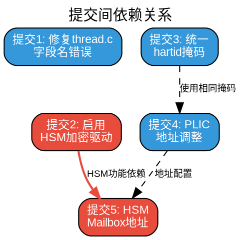

# OP-TEE OS 代码提交详细分析文档

**项目**: 芯来科技(Nuclei) RISC-V架构OP-TEE可信执行环境  
**分支**: dev_hsm  
**提交范围**: `b221263bb..e62501ffd`  
**生成日期**: 2026-04-03  

---

## 📋 提交概览

本次共提交 **5个commit**，涉及 **7个文件**，总修改 **+20行/-24行**。

| 序号 | 提交哈希 | 提交标题 | 修改文件数 | 修改行数 |
|------|----------|----------|-----------|----------|
| 1 | `8bd07d1ed` | arch/riscv: fix incorrect field name in thread_scall_handler | 1 | +1/-1 |
| 2 | `a2de38c5e` | plat-nuclei: enable HSM crypto driver | 1 | +6/-6 |
| 3 | `81507947a` | arch/riscv: unify hartid mask to 0x3 | 2 | +3/-2 |
| 4 | `270054978` | plat-nuclei: use absolute PLIC addresses and cleanup platform_config | 2 | +6/-12 |
| 5 | `e62501ffd` | drivers/crypto: update HSM mailbox base address | 1 | +4/-3 |

---

## 🔍 详细修改分析

### 提交 1: 修复thread.c字段名错误

**提交哈希**: `8bd07d1ed`  
**作者**: cryindance <cryindance@sina.com>  
**日期**: Fri Apr 3 00:16:16 2026 +0800

#### 修改文件
- `core/arch/riscv/kernel/thread.c`

#### 代码对比

```c
// 修改前 (第229行):
assert(sess && sess->handle_scall);

// 修改后 (第229行):
assert(sess && sess->handle_svc);
```

#### 技术解释

**问题描述**:
- `thread_scall_handler()` 函数处理来自用户态的系统调用(System Call)
- 断言检查 `sess->handle_scall` 是否存在，但该字段名是错误的
- 正确的字段名应该是 `handle_svc` (Supervisor Call)

**数据结构背景**:
```c
// struct tee_ta_session 结构体定义中包含:
struct tee_ta_session {
    // ... 其他字段
    bool (*handle_svc)(struct thread_svc_regs *regs);  // 系统调用处理函数指针
};
```

**影响分析**:
- ⚠️ **严重性**: 高
- 该断言可能在运行时失败，导致系统调用处理异常
- 修复后确保正确的回调函数被调用
- 这是功能性bug修复，不影响API兼容性

---

### 提交 2: 启用HSM加密驱动

**提交哈希**: `a2de38c5e`  
**作者**: cryindance <cryindance@sina.com>  
**日期**: Fri Apr 3 00:17:28 2026 +0800

#### 修改文件
- `core/arch/riscv/plat-nuclei/conf.mk`

#### 代码对比

```makefile
# 修改前 (第78-83行):
$(call force,CFG_SHART_FEATURE,y)
$(call force,CFG_NUCLEI_HSM_CRYPTO,n)
$(call force,CFG_CRYPTO_DRV_CIPHER,n)
$(call force,CFG_CRYPTO_DRV_HASH,n)
$(call force,CFG_CRYPTO_DRV_MAC,n)
$(call force,CFG_CRYPTO_DRV_ACIPHER,n)
$(call force,CFG_CRYPTO_DRV_RSA,n)

# 修改后 (第78-83行):
$(call force,CFG_SHART_FEATURE,y)
$(call force,CFG_NUCLEI_HSM_CRYPTO,y)
$(call force,CFG_CRYPTO_DRV_CIPHER,y)
$(call force,CFG_CRYPTO_DRV_HASH,y)
$(call force,CFG_CRYPTO_DRV_MAC,y)
$(call force,CFG_CRYPTO_DRV_ACIPHER,y)
$(call force,CFG_CRYPTO_DRV_RSA,y)
```

#### 技术解释

**配置项说明**:

| 配置项 | 修改 | 功能说明 |
|--------|------|----------|
| `CFG_NUCLEI_HSM_CRYPTO` | n → y | 启用芯来HSM硬件加密加速器 |
| `CFG_CRYPTO_DRV_CIPHER` | n → y | 启用对称加密驱动(AES等) |
| `CFG_CRYPTO_DRV_HASH` | n → y | 启用哈希算法驱动(SHA-256等) |
| `CFG_CRYPTO_DRV_MAC` | n → y | 启用消息认证码驱动(HMAC等) |
| `CFG_CRYPTO_DRV_ACIPHER` | n → y | 启用非对称加密驱动 |
| `CFG_CRYPTO_DRV_RSA` | n → y | 启用RSA算法支持 |

**技术意义**:
1. **性能提升**: 将加密操作从软件实现转移到硬件HSM加速
2. **安全性**: 密钥在HSM硬件中处理，不暴露于主内存
3. **功能启用**: 使能完整的硬件加密功能栈

**依赖关系**:
```
CFG_NUCLEI_HSM_CRYPTO (主控开关)
    ├── CFG_CRYPTO_DRV_CIPHER (对称加密)
    ├── CFG_CRYPTO_DRV_HASH (哈希)
    ├── CFG_CRYPTO_DRV_MAC (MAC)
    ├── CFG_CRYPTO_DRV_ACIPHER (非对称加密)
    └── CFG_CRYPTO_DRV_RSA (RSA)
```

**影响分析**:
- 🔴 **重要性**: 极高
- 这是本次提交的核心功能
- 启用后需要硬件HSM支持，否则可能导致启动失败
- 与mailbox地址配置(提交5)配合使用

---

### 提交 3: 统一hartid掩码

**提交哈希**: `81507947a`  
**作者**: cryindance <cryindance@sina.com>  
**日期**: Fri Apr 3 00:18:13 2026 +0800

#### 修改文件
1. `core/arch/riscv/include/riscv.h`
2. `core/arch/riscv/include/kernel/misc.h`

#### 文件1: riscv.h 修改

```c
// 修改前 (第62-70行):
#ifdef CFG_SHART_FEATURE
static inline __noprof unsigned long read_hartid(void)
{
    unsigned long hartid;
    asm volatile("csrr %0, 0xdc0" : "=r" (hartid));
    return hartid;
}
#endif

// 修改后 (第62-72行):
#ifdef CFG_SHART_FEATURE
#define SHARTID_MASK 0x3
static inline __noprof unsigned long read_hartid(void)
{
    unsigned long hartid;
    asm volatile("csrr %0, 0xdc0" : "=r" (hartid));
    return hartid&SHARTID_MASK;
}
#endif
```

#### 文件2: misc.h 修改

```c
// 修改前 (第21行):
return read_hartid() & 0xff;

// 修改后 (第21行):
return read_hartid() & 0x3;
```

#### 技术解释

**背景知识**:
- **HART**: RISC-V中的硬件线程(Hardware Thread)，相当于CPU核心
- **hartid**: 每个HART的唯一标识符，通过CSR寄存器0xdc0读取
- **SHART**: Shared HART特性，允许多个上下文共享HART

**修改目的**:
1. **统一掩码**: 将分散的 `0xff` 和 `0x3` 统一为 `0x3`
2. **定义常量**: 新增 `SHARTID_MASK` 宏，提高代码可维护性
3. **提取核心ID**: `hartid & 0x3` 提取低2位，支持最多4个核心(0-3)

**掩码对比**:
| 掩码值 | 二进制 | 支持核心数 | 说明 |
|--------|--------|-----------|------|
| `0xff` | `11111111` | 256 | 过大的范围，可能包含额外信息位 |
| `0x3` | `00000011` | 4 | 精确的2bit掩码，适合当前平台 |

**架构关系**:
```
┌─────────────────────────────────────────┐
│  OpenSBI (固件层)                        │
│  - 定义 HARTID_MASK = 0x3               │
└─────────────────────────────────────────┘
                    ↓
┌─────────────────────────────────────────┐
│  OP-TEE OS (安全OS层)                    │
│  - riscv.h: read_hartid() & SHARTID_MASK│
│  - misc.h: get_core_pos() & 0x3         │
└─────────────────────────────────────────┘
```

**影响分析**:
- 🟡 **重要性**: 中
- 确保OP-TEE与OpenSBI对hartid的解析一致
- 避免多核调度时的核心识别错误
- 为后续多核优化奠定基础

---

### 提交 4: PLIC地址配置调整

**提交哈希**: `270054978`  
**作者**: cryindance <cryindance@sina.com>  
**日期**: Fri Apr 3 00:19:11 2026 +0800

#### 修改文件
1. `core/arch/riscv/plat-nuclei/main.c`
2. `core/arch/riscv/plat-nuclei/platform_config.h`

#### 文件1: main.c 修改

```c
// 修改前:
#include <platform_config.h>

#define PLIC_CLAIM_SIZE       0x1000UL
#define PLIC_CLAIM_HART0_BASE (PLIC_BASE + 0x201000)
#define PLIC_CLAIM_HART1_BASE (PLIC_BASE + 0x203000)
#define PLIC_CLAIM_HART2_BASE (PLIC_BASE + 0x205000)
#define PLIC_CLAIM_HART3_BASE (PLIC_BASE + 0x207000)

// 修改后:
// (删除了 #include <platform_config.h>)

#define PLIC_CLAIM_SIZE         0x1000
#define PLIC_CLAIM_HART0_BASE 0x1c201000
#define PLIC_CLAIM_HART1_BASE 0x1c203000
#define PLIC_CLAIM_HART2_BASE 0x1c205000
#define PLIC_CLAIM_HART3_BASE 0x1c207000
```

**中断处理函数修改**:
```c
// 修改前 (第43行):
    hartid = hartid & 0xFF;

// 修改后 (第43行):
    hartid = hartid & 0x3;
```

#### 文件2: platform_config.h 修改

```c
// 删除的内容 (第19-22行):
- #define NUCLEI_MAILBOX_BASE       (0x97000000UL)
- #define NUCLEI_MAILBOX_SIZE       (0x4000UL)
- #define PLIC_BASE                 (0x4000000UL)
```

#### 技术解释

**PLIC简介**:
- **PLIC**: Platform-Level Interrupt Controller (平台级中断控制器)
- 负责管理RISC-V系统的外部中断
- 每个HART有独立的claim/complete寄存器

**地址映射变化**:

| HART | 修改前地址 | 修改后地址 | 说明 |
|------|-----------|-----------|------|
| HART0 | 0x4000000 + 0x201000 = 0x4201000 | 0x1c201000 | S-mode claim |
| HART1 | 0x4000000 + 0x203000 = 0x4203000 | 0x1c203000 | S-mode claim |
| HART2 | 0x4000000 + 0x205000 = 0x4205000 | 0x1c205000 | S-mode claim |
| HART3 | 0x4000000 + 0x207000 = 0x4207000 | 0x1c207000 | S-mode claim |

**修改原因**:
1. **地址更新**: PLIC控制器在硬件中已移动到新的内存区域(0x1c20xxxx)
2. **简化配置**: 直接使用绝对地址，避免宏嵌套
3. **清理代码**: 删除platform_config.h中不再使用的宏定义
4. **统一风格**: 应用0x3掩码保持一致性

**PLIC内存布局**:
```
0x1c200000 +------------------+
           |  PLIC 中断源配置  |
0x1c201000 +------------------+
           | HART0 Claim/Cmpl |
0x1c203000 +------------------+
           | HART1 Claim/Cmpl |
0x1c205000 +------------------+
           | HART2 Claim/Cmpl |
0x1c207000 +------------------+
           | HART3 Claim/Cmpl |
           +------------------+
```

**影响分析**:
- 🔴 **重要性**: 高
- PLIC地址必须与硬件实际地址匹配，否则中断无法工作
- 这是硬件相关的配置变更
- 与OpenSBI中的PLIC配置需要保持一致

---

### 提交 5: HSM Mailbox地址更新

**提交哈希**: `e62501ffd`  
**作者**: cryindance <cryindance@sina.com>  
**日期**: Fri Apr 3 00:20:44 2026 +0800

#### 修改文件
- `core/drivers/crypto/nuclei/nuclei_hsm_cryp.c`

#### 代码对比

```c
// 修改前:
void* mailbox_base;

register_phys_mem(MEM_AREA_IO_SEC, NUCLEI_MAILBOX_BASE, NUCLEI_MAILBOX_SIZE);

static TEE_Result nuclei_hsm_cryp_init(void)
{
    // ...
    mailbox_base = (void *)core_mmu_get_va(NUCLEI_MAILBOX_BASE, MEM_AREA_IO_SEC,
        NUCLEI_MAILBOX_SIZE);
    // ...
}

// 修改后:
#define MAILBOX_BASE       (0x8800000UL)
void* mailbox_base;

register_phys_mem(MEM_AREA_IO_SEC, MAILBOX_BASE, 0x4000);

static TEE_Result nuclei_hsm_cryp_init(void)
{
    // ...
    mailbox_base = (void *)core_mmu_get_va(MAILBOX_BASE, MEM_AREA_IO_SEC,
        0x1000);
    // ...
}
```

#### 技术解释

**Mailbox机制**:
- **Mailbox**: CPU与HSM(硬件安全模块)之间的共享内存通信区域
- CPU将加密请求写入mailbox，HSM读取处理并返回结果
- 需要配置为**非缓存(non-cacheable)**以确保数据一致性

**关键变更**:

| 参数 | 修改前 | 修改后 | 说明 |
|------|--------|--------|------|
| **基地址** | `0x97000000` | `0x8800000` | 移动到新的内存区域 |
| **物理内存注册大小** | `0x4000` (16KB) | `0x4000` (16KB) | 保持不变 |
| **虚拟地址映射大小** | `NUCLEI_MAILBOX_SIZE` | `0x1000` (4KB) | 仅映射实际使用区域 |

**地址变更原因**:
1. **硬件设计变更**: 新版本的芯来平台将mailbox移动到0x8800000
2. **内存布局优化**: 避免与其他外设地址冲突
3. **与OpenSBI协调**: OpenSBI中已同步配置该地址的非缓存属性

**内存注册流程**:
```c
// 步骤1: 注册物理内存区域
register_phys_mem(MEM_AREA_IO_SEC, MAILBOX_BASE, 0x4000);
//       ↑ 标记为安全的IO内存区域

// 步骤2: 启动时映射到虚拟地址
mailbox_base = core_mmu_get_va(MAILBOX_BASE, MEM_AREA_IO_SEC, 0x1000);
//       ↑ 返回虚拟地址指针，供后续访问使用
```

**与OpenSBI的协作**:
```
┌─────────────────────────────────────────────────────┐
│ OpenSBI (固件层)                                     │
│ - 配置MATTRI寄存器: 0x8800000-0x8803FFF = 非缓存     │
│ - 确保CPU访问mailbox时不使用缓存                     │
└─────────────────────────────────────────────────────┘
                        ↓
┌─────────────────────────────────────────────────────┐
│ OP-TEE OS (安全OS层)                                 │
│ - nuclei_hsm_cryp.c: 映射mailbox内存               │
│ - 通过mailbox与HSM进行安全通信                       │
└─────────────────────────────────────────────────────┘
                        ↓
┌─────────────────────────────────────────────────────┐
│ HSM (硬件安全模块)                                   │
│ - 直接访问0x8800000物理地址                          │
│ - 执行加密操作并返回结果                              │
└─────────────────────────────────────────────────────┘
```

**影响分析**:
- 🔴 **重要性**: 极高
- 地址必须与硬件设计完全匹配
- 需要OpenSBI配合配置内存属性
- 这是HSM功能正常工作的关键配置

---

## 🔗 提交间关联关系



### 依赖关系说明

1. **提交3 → 提交4**: 都使用了 `0x3` hartid掩码，确保多核处理一致性
2. **提交2 → 提交5**: HSM驱动(提交2)依赖正确的mailbox地址(提交5)
3. **提交4 → 提交5**: 都是硬件平台相关的地址配置变更

---

## 📊 修改影响总结

### 功能影响矩阵

| 功能领域 | 提交1 | 提交2 | 提交3 | 提交4 | 提交5 | 总体影响 |
|----------|:-----:|:-----:|:-----:|:-----:|:-----:|:--------:|
| **系统调用** | 🔴 | - | - | - | - | 修复bug |
| **加密加速** | - | 🔴 | - | - | 🔴 | 启用HSM |
| **多核支持** | - | - | 🟡 | 🟡 | - | 优化一致 |
| **中断处理** | - | - | - | 🔴 | - | 地址更新 |
| **内存管理** | - | - | - | - | 🔴 | 映射调整 |

### 风险评估

| 提交 | 风险等级 | 原因 | 缓解措施 |
|------|----------|------|----------|
| 提交1 | 🟢 低 | 简单的字段名修复 | 代码审查确保正确 |
| 提交2 | 🟡 中 | 启用新功能 | 确保HSM硬件可用 |
| 提交3 | 🟢 低 | 值调整，逻辑不变 | 功能等效 |
| 提交4 | 🔴 高 | 硬件地址变更 | 需匹配硬件设计 |
| 提交5 | 🔴 高 | 硬件地址变更 | 需OpenSBI配合配置 |

---

## 📝 代码审查要点

### 关键审查项

1. **HARTID掩码一致性**
   - [ ] `riscv.h` 中 `SHARTID_MASK` 定义为 `0x3`
   - [ ] `misc.h` 中使用 `0x3` 而非 `0xff`
   - [ ] `main.c` 中断处理使用 `0x3` 掩码

2. **HSM功能启用检查**
   - [ ] `conf.mk` 中所有相关配置项设为 `y`
   - [ ] HSM驱动能够正确初始化
   - [ ] mailbox地址与OpenSBI配置匹配

3. **PLIC地址正确性**
   - [ ] 新地址 `0x1c20xxxx` 与硬件设计一致
   - [ ] 删除的旧宏不再被引用
   - [ ] 中断处理正常工作

4. **Mailbox配置验证**
   - [ ] 基地址 `0x8800000` 正确
   - [ ] OpenSBI已配置为非缓存区域
   - [ ] HSM能够通过mailbox通信

---

## 🔮 后续建议

### 测试建议

1. **功能测试**
   - 验证TEE系统调用正常工作
   - 测试HSM加密功能(加密、解密、签名、验签)
   - 多核并发加密测试

2. **性能测试**
   - 对比软件加密 vs HSM硬件加速性能
   - 测量mailbox通信延迟

3. **兼容性测试**
   - 确保与OpenSBI版本匹配
   - 验证不同hartid情况下的稳定性

### 文档建议

1. 更新平台移植指南，记录新的PLIC和mailbox地址
2. 添加HSM功能启用说明
3. 维护地址映射表，与硬件设计文档保持同步

---

*文档生成时间: 2026-04-03 15:45*  
*分析工具: Git + 手动代码审查*
