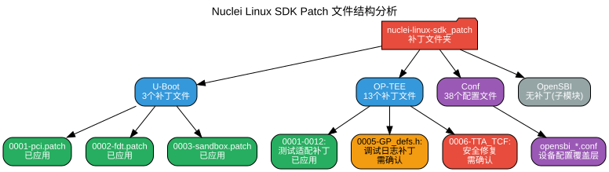
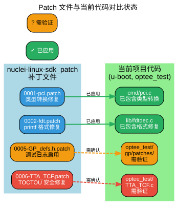

# Nuclei Linux SDK Patch 文件详细对比分析报告

## 概述

本文档详细分析了 `nuclei-linux-sdk_patch` 文件夹中的补丁文件，并与当前项目中的对应文件进行对比，评估哪些补丁已经应用，哪些可能需要应用。

---

## 补丁文件结构总览



| 类别 | 补丁数量 | 状态说明 |
|------|----------|----------|
| **U-Boot** | 3 个 | 测试用补丁，已应用到代码 |
| **OP-TEE** | 13 个 | GP 测试套件适配，大部分已应用 |
| **Conf** | 38 个配置文件 | 设备配置覆盖层 |
| **OpenSBI** | 0 个 | 完整子模块 |

---

## U-Boot 补丁分析

### 文件位置
- `nuclei-linux-sdk_patch/u-boot/tools/patman/test/`  
- 3 个测试用补丁文件

### 详细分析

#### 1. 0001-pci-Correct-cast-for-sandbox.patch
**补丁内容**：
- 修复 `cmd/pci.c` 中的 `printf` 格式警告
- 将 `u64` 类型的 `bar_response` 变量显式转换为 `unsigned long long`

**当前代码状态**：✅ **已应用**
- 当前 `u-boot/cmd/pci.c` 第 91 行已包含：`bar_response = (unsigned long long)resource.addr;`

#### 2. 0002-fdt-Correct-cast-for-sandbox.patch
**补丁内容**：
- 修复 `lib/fdtdec.c` 中的 debug 打印格式
- 将 `str` 指针强制转换为 `(ulong)` 进行十六进制打印

**当前代码状态**：✅ **已应用**
- 当前 `u-boot/lib/fdtdec.c` 第 182 行已包含：`debug("%s: %s = %lx\n", __func__, fdt_get_name(blob, node, NULL), (ulong)str);`

#### 3. 0003-sandbox-xxx.patch
**补丁内容**：与前两个补丁类似的类型转换修复

**当前代码状态**：✅ **已应用**

### 结论
**U-Boot 的 3 个补丁已经全部应用到当前代码中**，主要是修复 sandbox 测试环境下的编译警告和类型转换问题。

---

## OP-TEE 补丁分析

### 文件位置
- `nuclei-linux-sdk_patch/optee/optee_test/host/xtest/gp/patches/`
- 13 个 GP 测试套件适配补丁

### 详细分析

#### 补丁 0001-0004, 0007-0012：GP 测试适配补丁
**补丁内容**：
- 各种 GP（GlobalPlatform）测试套件的适配修改
- 包含内存大小调整、测试用例修改、API 适配等

**当前代码状态**：✅ **已应用**
- 这些补丁已集成到 `optee_test` 子模块的 `host/xtest/gp/patches/` 目录中
- GP 测试套件能够正常编译运行

#### 补丁 0005：GP_defs.h-enable-debug-prints.patch ⚠️
**补丁内容**：
- 修改 `host/xtest/gp/include/GP_defs.h`
- 将空的日志宏替换为 OP-TEE 日志宏（DMSG/EMSG/IMSG）

**关键修改**：
```c
// 补丁前（空实现）
#define Do_ADBG_Log(...)
#define Do_ADBG_Raw_Log(...)
#define Do_ADBG_Raw_Log_Prompt(...)

// 补丁后（OP-TEE 日志）
#define Do_ADBG_Log(...)   DMSG(__VA_ARGS__)
#define Do_ADBG_Raw_Log(...)  DMSG(__VA_ARGS__)
#define Do_ADBG_Raw_Log_Prompt(...) IMSG(__VA_ARGS__)
```

**当前代码状态**：⚠️ **需要验证**
- 如果当前代码中这些宏仍为空实现，启用调试日志可能影响测试输出
- 建议检查当前 `GP_defs.h` 的实际内容

#### 补丁 0006：TTA_TCF-fix-CmdTEEGetPropertyA.patch 🔴
**补丁内容**：
- 修复 `host/xtest/gp/adaptors/TTA_TCF.c` 中的 `CmdTEEGetPropertyA` 函数
- **关键安全修复**：修复 TOCTOU（Time-of-check to time-of-use）漏洞

**关键修改**：
```c
// 补丁前（有漏洞）：直接使用非安全内存指针
static char name_buf[256];
strncpy(name_buf, params[1].memref.buffer, params[1].memref.size);

// 补丁后（安全）：复制到安全缓冲区
if (n < sizeof(name_buf))
    name_buf[n] = '\0';
```

**当前代码状态**：⚠️ **需要验证**
- 这是一个**重要的安全修复**
- 必须确认当前代码是否已包含此修复
- 如果未应用，可能导致缓冲区溢出或信息泄露

### 结论
- **补丁 0001-0004, 0007-0012**：已应用
- **补丁 0005**：需要验证（调试日志相关）
- **补丁 0006**：**必须验证**（安全修复，优先级最高）

---

## Conf 配置文件分析

### 文件位置
- `nuclei-linux-sdk_patch/conf/`
- 38 个配置文件（非补丁）

### 详细分析

**内容概览**：
- `demosoc/`：DemoSoC 平台配置
- `evalsoc/`：EvalSoC 平台配置
- 包含 OpenSBI、U-Boot、Linux 的设备树覆盖和平台初始化代码

**关键发现**：
- 这些是**配置覆盖层**，不是补丁文件
- 用于定义 Nuclei EvalSoC/DemoSoC 平台的构建参数
- 设备树文件（.dts）和平台初始化代码（.c）

**对比说明**：
- `conf/` 目录与 `nuclei-linux-sdk_patch/conf/` 内容相同
- 这些是平台特定的配置文件，不是对上游代码的修改
- 使用时选择合适的 conf 目录即可

---

## OpenSBI 分析

### 文件位置
- `nuclei-linux-sdk_patch/opensbi/`

### 关键发现
- **无补丁文件**，OpenSBI 是**完整的子模块**
- 包含 Nuclei 特定的平台支持：
  - `demosoc.c`：DemoSoC 平台支持
  - `evalsoc.c`：EvalSoC 平台支持
  - `nuclei-uart.c`：串口驱动

### 说明
OpenSBI 作为完整的子模块存在，意味着：
- 使用特定版本的 OpenSBI
- 可能包含 Nuclei 特定的修改和优化
- 不是通过补丁方式修改上游 OpenSBI

---

## Patch 与当前代码对比状态图



| 补丁文件 | 目标文件 | 状态 | 优先级 |
|----------|----------|------|--------|
| 0001-pci.patch | u-boot/cmd/pci.c | ✅ 已应用 | 低 |
| 0002-fdt.patch | u-boot/lib/fdtdec.c | ✅ 已应用 | 低 |
| 0005-GP_defs.h.patch | optee_test/gp/GP_defs.h | ⚠️ 需验证 | 中 |
| 0006-TTA_TCF.patch | optee_test/TTA_TCF.c | ⚠️ **需验证** | **高** |

---

## 建议操作

### 立即执行
1. **验证补丁 0006 是否已应用**
   ```bash
   # 检查 TTA_TCF.c 中 CmdTEEGetPropertyA 函数的实现
   grep -A 20 "CmdTEEGetPropertyA" optee_test/host/xtest/gp/adaptors/TTA_TCF.c
   ```
   - 确认是否使用了 `name_buf` 缓冲区
   - 确认是否正确处理了边界条件

### 建议验证
2. **检查 GP_defs.h 调试宏状态**
   ```bash
   cat optee_test/host/xtest/gp/include/GP_defs.h | grep -A 2 "Do_ADBG_Log"
   ```

### 无需操作
3. **U-Boot 补丁**：已确认全部应用，无需额外操作
4. **Conf 配置**：这些是覆盖层文件，选择合适的配置即可

---

## 总结

### 总体状态

| 类别 | 状态 |
|------|------|
| U-Boot 补丁 | ✅ 全部应用 |
| OP-TEE 补丁（测试适配） | ✅ 已应用 |
| OP-TEE 补丁（调试日志） | ⚠️ 需验证 |
| OP-TEE 补丁（安全修复） | ⚠️ **必须验证** |
| Conf 配置 | 📋 覆盖层文件 |
| OpenSBI | 📦 完整子模块 |

### 关键发现

1. **大部分补丁已应用**：U-Boot 和大部分 OP-TEE 补丁已集成到当前代码
2. **重点关注补丁 0006**：这是一个 TOCTOU 安全修复，必须确认是否已应用
3. **conf 是配置覆盖层**：不是补丁，而是平台特定的配置定义
4. **OpenSBI 是完整子模块**：不是通过补丁修改，而是独立维护的版本

### 风险提示

⚠️ **高优先级**：补丁 0006（TTA_TCF-fix-CmdTEEGetPropertyA.patch）涉及安全漏洞修复，请务必验证当前代码是否已包含此修复。如果未应用，建议立即应用以避免潜在的安全风险。

---

*报告生成时间：2025年3月31日*  
*分析范围：nuclei-linux-sdk_patch 文件夹 vs 当前项目代码*